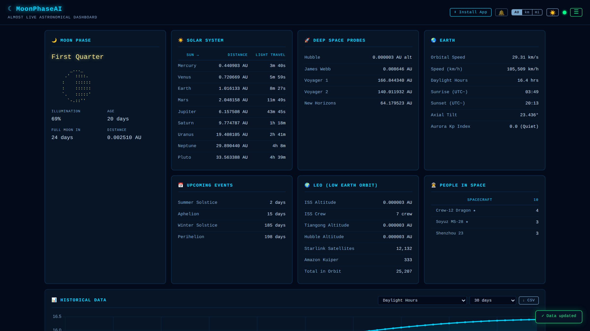

# MoonPhaseAI

MoonPhaseAI is a Java Spring Boot application that calculates astronomical data including moon phases, planetary distances, light travel times, and solstice timings. It runs as a scheduled background task, pushes updates to an [Awtrix](https://awtrixdocs.blueforcer.de/) device, and optionally serves a live web dashboard accessible in any browser.

## Features

The application performs the following calculations on a configurable schedule (default: 00:01 and 12:01 UTC daily):

### Moon Phase
- Calculates the current moon phase, age (days since new moon), and illumination percentage.
- Displays an ASCII art representation of the moon in the logs.
- Verifies the calculated phase against the Claude AI API and logs any discrepancy (the deterministic formula result is always used).
- Sends the moon phase name, illumination %, and days until next full moon to the Awtrix device.

### Solar System Distances
- **Sun–Earth**: Current distance in AU with annual min/max comparison.
- **Earth–Mars**: Current distance in AU with annual min/max comparison.
- **Earth–Jupiter**: Current distance in AU with annual min/max comparison.
- **Earth–Saturn**: Current distance in AU with annual min/max comparison.
- **Moon**: Current distance in km with annual min/max comparison.

### Deep Space Probes
- **Voyager 1 & 2**: Estimated distance from Earth in AU.
- **New Horizons**: Estimated distance from Earth in AU.
- **James Webb Space Telescope**: Current distance from Earth in km.

### Light Travel Times
- All times measured from the Sun, ordered by distance: Sun→Mercury, Sun→Venus, Sun→Earth, Sun→Mars, Sun→Jupiter, Sun→Saturn, Sun→Uranus, Sun→Neptune, Sun→Pluto, Sun→Voyager 2, Sun→Voyager 1.

### Earth
- Current orbital speed in km/s and km/h.
- Daylight hours, approximate sunrise and sunset times (UTC) for a configurable latitude/longitude (default: 51.4769° N, 0.0° E — Greenwich).
- Current axial tilt in degrees (IAU obliquity formula, currently ~23.436°).
- **Aurora geomagnetic activity**: Current Kp index from NOAA Space Weather Services (0–9 scale).

### LEO (Low Earth Orbit)
Live data fetched from the [TLE API](https://tle.ivanstanojevic.me/) on every scheduled run:
- **ISS altitude**: Derived from live TLE data via Kepler's third law.
- **Tiangong altitude**: Derived from live TLE data (Tianhe core module).
- **Hubble altitude**: Derived from live TLE data.
- **Starlink satellites**: Count of active Starlink TLE entries.
- **Amazon Kuiper satellites**: Count of active Kuiper TLE entries.
- **Total in orbit**: Count of all catalogued objects queried directly from the TLE API (not just Starlink + Kuiper).
- **ISS crew**: Number of people currently aboard the ISS.
- **People in space**: Total count and per-spacecraft breakdown of all humans in space.

### Upcoming Events
- Days until next Summer Solstice, Winter Solstice, Perihelion, and Aphelion.

### Awtrix Integration
- Checks connectivity to the Awtrix device at startup.
- Pushes all metrics to the `/api/custom` endpoint on the configured Awtrix server.
- Aurora Kp index is pushed on every run; the label is prefixed with `⚡` during a geomagnetic storm (Kp ≥ 5).

---

## Web Dashboard

MoonPhaseAI includes an optional live web dashboard that displays all computed metrics in a browser, updated in real time via Server-Sent Events (SSE) whenever the scheduled calculation cycle completes.



The dashboard is **enabled by default** and accessible at `http://localhost:8080/` (or the configured port).

---

### Header

The sticky header contains:

| Control | Description |
|---|---|
| **⇩ Install App** | Appears on supported browsers — installs the PWA to the desktop or home screen. |
| **🔔 Bell** | Enables browser notifications for aurora storms and full moon events (see [Browser Notifications](#browser-notifications)). |
| **AU / km / mi** | Unit selector — switches all distance values on the page between Astronomical Units, kilometres, and miles. Preference is saved to `localStorage`. |
| **Theme** | Switches look and feel between Classic, Light, SpaceX, NASA, Blue Origin, Rocket Lab, ULA, Arianespace, Relativity, and Firefly. Preference is saved to `localStorage`. |
| **● SSE dot** | Live connection indicator: green = connected, amber = connecting, red = disconnected. |
| **☰ Menu** | Hamburger menu containing **↻ Refresh**, **🗑 Reset Data**, and **📅 Populate Past**. |

---

### Dashboard Cards

#### 🌙 Moon Phase
Displays the current phase name and a moon graphic, plus four statistics. Use the **ASCII / Animated** switch in the card header to choose the graphic; your choice is remembered in the browser.

- **ASCII** — the server-generated ASCII art rendering of the current phase (default).
- **Animated** — a canvas-rendered moon with craters and maria, a shadowed terminator matching the live illumination and age, and a twinkling starfield. A moon base sits on the surface while a Starship repeatedly lands beside it, kicking up dust. The phase is synced to each server snapshot and then advances in real time between updates. Star colours adapt to light themes.

Statistics:
- **Illumination** — percentage of the visible surface lit by the Sun.
- **Age** — days elapsed since the last new moon.
- **Full Moon In** — days until the next full moon.
- **Distance** — current Earth–Moon distance, respecting the active unit selector.

#### ☀️ Solar System
A table of all nine planets from Mercury to Pluto, each showing:
- **Distance** from the Sun (heliocentric), respecting the active unit selector.
- **Light travel time** from the Sun to that planet.

#### 🚀 Deep Space Probes
Current distances for:
- **Hubble** — altitude above Earth (LEO).
- **James Webb** — distance from Earth (at L2).
- **Voyager 1 & 2** — distance from Earth.
- **New Horizons** — distance from Earth.

#### 🌍 Earth
| Row | Description |
|---|---|
| Orbital Speed | Current speed in km/s |
| Speed (km/h) | Same speed in km/h |
| Daylight Hours | Hours of daylight at the configured latitude |
| Sunrise (UTC~) | Approximate sunrise time in UTC |
| Sunset (UTC~) | Approximate sunset time in UTC |
| Axial Tilt | Earth's current axial tilt in degrees |
| Aurora Kp Index | Latest NOAA Kp index with activity label (Quiet / Unsettled / Active / Storm ⚡) |

#### 📅 Upcoming Events
A table of the four next orbital events — Summer Solstice, Winter Solstice, Perihelion, and Aphelion — sorted in ascending order by days remaining.

#### 🌍 LEO (Low Earth Orbit)
| Row | Description |
|---|---|
| ISS Altitude | Altitude derived from live TLE data via Kepler's third law |
| ISS Crew | Number of people currently aboard the ISS |
| Tiangong Altitude | Altitude of the Tianhe core module |
| Hubble Altitude | Hubble Space Telescope altitude |
| Starlink Satellites | Count of active Starlink TLE entries |
| Amazon Kuiper | Count of active Kuiper TLE entries |
| Total in Orbit | Total catalogued objects from the TLE API |

#### 👨‍🚀 People in Space
A per-spacecraft table of everyone currently in space. The column header shows the total count. Spacecraft docked to the ISS are marked with a **★** suffix.

#### 📊 Historical Data
Requires MongoDB (see Configuration). Controls:
- **Metric selector** — grouped dropdown covering all graphable metrics (see table below).
- **Date range** — 7 / 14 / 30 / 90 / 365 days, or all (max 500 points).
- **↓ CSV** — downloads the currently displayed metric and range as a CSV file.

The chart is a Chart.js line graph, updated automatically via SSE after each calculation cycle. If MongoDB is not configured, the card is hidden.

#### 🐳 Docker Hub
A QR code linking to [hub.docker.com/r/jamieharwood/moonphase](https://hub.docker.com/r/jamieharwood/moonphase).

---

### Manual Refresh

The **↻ Refresh** option in the hamburger menu triggers an immediate recalculation without waiting for the next scheduled run. The dashboard spinner remains active until the SSE update arrives with the new data. Clicking Refresh while one is already in progress returns a `429` response and shows a toast notification — duplicate runs are not queued.

---

### Historical Graph

A data point is saved to MongoDB on every scheduled run. The cron fires **twice daily** (00:01 and 12:01 UTC), so both runs save independently — up to two points per day. Manual refreshes within the same 12-hour window are deduplicated and do not create extra history entries.

The metric dropdown covers all computed numeric metrics:

| Category | Metrics |
|---|---|
| Moon | Illumination (%), Age (days), Distance (km), Days Until Full Moon, Daylight Hours |
| Solar System | Sun, Mercury, Venus, Mars, Jupiter, Saturn, Uranus, Neptune, Pluto distances (AU); Voyager 1 & 2 heliocentric distances |
| Deep Space Probes | Voyager 1, Voyager 2, New Horizons (AU) |
| Earth | Orbital speed (km/s and km/h), Axial Tilt (°), Aurora Kp Index |
| LEO | ISS & Tiangong & Hubble altitudes (km); Starlink, Kuiper, Total counts; ISS crew; Total people in space |
| Upcoming Events | Days until Summer Solstice, Winter Solstice, Perihelion, Aphelion |

History can be automatically pruned by setting `APP_HISTORY_RETENTION_DAYS` (see Configuration). When set, snapshots older than the configured number of days are deleted nightly at 03:00 UTC.

The **📅 Populate Past** option in the hamburger menu backfills historical data for a user-specified number of past days (1–365) using the deterministic calculation engine. LEO and aurora data cannot be reconstructed historically and will be zero in backfilled records.

---

### Browser Notifications

A 🔔 bell button appears in the header on browsers that support the Notifications API. Click it once to grant permission. After that, the dashboard will send a browser notification when:

- A **geomagnetic storm** is detected (Kp ≥ 5) — visible aurora may be possible at mid-latitudes.
- The **full moon is tonight** (0 days remaining) or **tomorrow** (1 day remaining).

Notifications are throttled — the same alert will not repeat within 6 hours. Notifications work in both the browser tab and when installed as a PWA.

---

### Installing as an app

The dashboard is a Progressive Web App (PWA). Once the page has loaded:

- **Chrome / Edge (desktop):** an **⇩ Install App** button appears in the header — click it to install as a standalone desktop app.
- **Chrome (Android):** the install button appears in the header, or use the browser's "Add to Home Screen" option.
- **Safari (iOS/macOS):** tap Share → "Add to Home Screen" — uses the dedicated 180×180 touch icon.

The installed app uses a network-first service worker so live data is never stale. All static assets are cached for offline resilience.

> **Note:** The PWA install prompt requires the site to be served over **HTTPS**. On `localhost` it works without TLS for local testing. For production, place the container behind a reverse proxy (e.g. nginx + Let's Encrypt).

---

### Disabling the dashboard (headless mode)

To run without a web server (e.g. on a resource-constrained device), set the following environment variable:

```
SPRING_MAIN_WEB-APPLICATION-TYPE=none
```

---

## REST API

| Method | Endpoint | Description |
|---|---|---|
| `GET` | `/api/data` | Returns the latest `AstronomicalSnapshot` as JSON. `503` if no data yet. |
| `GET` | `/api/events` | SSE stream — emits an `update` event with the full snapshot on every calculation cycle. |
| `POST` | `/api/refresh` | Triggers an immediate recalculation. Returns `202 Accepted` or `429` if one is already running. |
| `GET` | `/api/health` | Returns application health: snapshot availability, history status, and whether a refresh is in progress. |
| `GET` | `/api/history?metric=X&limit=N` | Returns up to N historical data points for metric X, oldest first. |
| `GET` | `/api/history/export?metric=X&limit=N` | Downloads history as a CSV file. |
| `POST` | `/api/history/populate?days=N` | Backfills historical snapshots for the past N days (1–365). Runs asynchronously. |
| `DELETE` | `/api/history` | Deletes all stored snapshots. |

### Health response example

```json
{
  "status": "UP",
  "dataAvailable": true,
  "lastUpdated": "2026-06-19T00:01:00",
  "historyEnabled": true,
  "components": {
    "snapshot": "UP",
    "history": "UP",
    "refreshRunning": false
  }
}
```

---

## Configuration

All configuration is via environment variables (or `application.properties`):

| Variable | Default | Description |
|---|---|---|
| `AWTRIXHOSTNAME` | `http://moonclock.local` | Base URL of the Awtrix device |
| `LATITUDE` | `51.4769` | Latitude in decimal degrees (positive = North). Invalid values fall back to Greenwich. |
| `LONGITUDE` | `0.0` | Longitude in decimal degrees (positive = East). Invalid values fall back to 0.0. |
| `CRON_SCHEDULE` | `0 1 0,12 * * *` | Spring cron expression for the update schedule |
| `CLAUDE_API_KEY` | _(none)_ | Anthropic API key for moon phase verification (optional) |
| `CLAUDE_MODEL` | `claude-sonnet-4-6` | Claude model ID to use for moon phase verification |
| `SERVER_PORT` | `8080` (local) / `8081` (Docker) | Port the web dashboard listens on |
| `SPRING_MAIN_WEB-APPLICATION-TYPE` | `servlet` | Set to `none` to disable the web dashboard |
| `APP_HISTORY_ENABLED` | `false` | Set to `true` to enable MongoDB history storage |
| `APP_HISTORY_RETENTION_DAYS` | `0` | Days of history to retain (0 = keep all). Older snapshots are purged nightly at 03:00 UTC. |
| `SPRING_DATA_MONGODB_URI` | _(none)_ | MongoDB connection URI, e.g. `mongodb://localhost:27017/moonphase` |

---

## Running with Docker

The recommended way to run MoonPhaseAI is via Docker. Create an `env` file (do not commit to version control):

```
AWTRIXHOSTNAME=http://your-awtrix-device.local
LATITUDE=53.4808
LONGITUDE=-2.2426
CLAUDE_API_KEY=your-api-key-here
```

Then start the container:

```bash
docker compose up -d
```

The included `docker-compose.yml` starts both the application and a MongoDB container. MongoDB is exposed on port **27017** so you can connect with [MongoDB Compass](https://www.mongodb.com/products/compass) or any other client using:

```
mongodb://<host-ip>:27017
```

The historical data is stored in the `moonphase` database, `snapshots` collection.

To change the dashboard port, edit `SERVER_PORT` in `docker-compose.yml`:

```yaml
- SERVER_PORT=9090
```

Or pull the latest image directly from Docker Hub:

```bash
docker pull jamieharwood/moonphase:latest
```

---

## Building

```bash
./gradlew bootJar
```

Or build the Docker image:

```bash
docker build -t jamieharwood/moonphase:latest .
```

---

## Awtrix Apps

The following named apps are pushed to the Awtrix device on every scheduled or manual run:

| App Name | Content | Icon |
|---|---|---|
| `moonphase` | Current phase name | Phase icon |
| `moonillumination` | Illumination % | Phase icon |
| `fullmoon` | Days until next full moon | `FullMoon` |
| `marsDistanceAu` | Earth–Mars distance in AU | `MARS` |
| `jupiterDistanceAu` | Earth–Jupiter distance in AU | `JUPITER` |
| `saturnDistanceAu` | Earth–Saturn distance in AU | `SATURN` |
| `voyager1` | Voyager 1 distance in AU | `VOYAGER` |
| `voyager2` | Voyager 2 distance in AU | `VOYAGER` |
| `newhorizons` | New Horizons distance in AU | `NEWHORIZONS` |
| `summersolstice` | Days until summer solstice | `SUMMER` |
| `wintersolstice` | Days until winter solstice | `WINTER` |
| `CurrentDayLength` | Current daylight hours | `DAYLENGTH` |
| `earthSpeed` | Earth orbital speed in km/s | `EARTH` |
| `moonDistance` | Moon distance in km | `MOON` |
| `perihelion` | Days until perihelion | `PERIHELION` |
| `aphelion` | Days until aphelion | `PERIHELION` |
| `lightMars` | Light travel time to Mars | `LIGHT` |
| `lightJupiter` | Light travel time to Jupiter | `LIGHT` |
| `auroraKp` | Current Kp index (`⚡Kp5.0` during storms) | `AURORA` |
